  

# 💼 Awesome Job Board & Recruitment Portal 🚀

  
  
  
  
  
  
  

> 🌟 **Top Open-Source Applicant Tracking Systems (ATS), Job Board Platforms, AI Resume Parsers & Enterprise Recruitment Portals.** 🌟
> Star this repository if you find it helpful! ⭐

An expertly curated index of **production-ready Open-Source recruitment platforms, modern applicant tracking systems (ATS), developer job boards, and automated resume parsers**, paired with comprehensive intelligence on **major SaaS talent acquisition suites, pricing models, and market capitalization metrics**.

---

## 📑 Contents 🧭

- [📊 Sector Overview & Market Dynamics](#-sector-overview--market-dynamics)
- [🌐 SaaS / Hosted Recruitment Platforms](#-saas--hosted-recruitment-platforms)
  - [🏢 Global Job Boards & Talent Aggregators](#-global-job-boards--talent-aggregators)
  - [☁️ Cloud ATS & Enterprise Recruitment Suites](#-cloud-ats--enterprise-recruitment-suites)
- [🔓 Open-Source Recruitment & Job Board Software](#-open-source-recruitment--job-board-software)
  - [🎯 Full-Featured ATS & Recruitment Suites](#-full-featured-ats--recruitment-suites)
  - [📢 Standalone Job Board & Career Portal Engines](#-standalone-job-board--career-portal-engines)
  - [🏢 HRIS & ERP Modules with Built-In Recruitment](#-hris--erp-modules-with-built-in-recruitment)
  - [🧠 AI Resume Parsers, Matchers & Job Scrapers](#-ai-resume-parsers-matchers--job-scrapers)
- [📈 Star History](#-star-history)
- [💖 Support & Sponsorship](#-support--sponsorship)
- [🤝 Contributing](#-contributing)

---

## 📊 Sector Overview & Market Dynamics 📈

The global talent acquisition and recruitment software market is valued at approximately **$32.5 Billion** and is projected to expand past **$55 Billion** by 2030 at a CAGR of 7.8%. The market displays **moderate fragmentation transitioning toward consolidation**: the top tier exhibits a "winner-take-all" dynamic in global talent liquidity and networking (dominated by Microsoft LinkedIn and Recruit Holdings/Indeed), while mid-market and enterprise applicant tracking systems (Greenhouse, Workday, SmartRecruiters) compete fiercely against specialized vertical and AI-native sourcing startups.

---

## 🌐 SaaS / Hosted Recruitment Platforms 💼

### 🏢 Global Job Boards & Talent Aggregators 🌍

Sorted descending by company size (Valuation / Market Capitalization / Annual Revenue):

| Platform | Description | Size / Revenue / Valuation | Starting Pricing | Free Tier / Trial Limits |
| :--- | :--- | :--- | :--- | :--- |
| [LinkedIn Jobs](https://linkedin.com) | Professional social network, candidate sourcing network, and premier global job aggregation marketplace. | **$3.1+ Trillion** (Parent: Microsoft Corp / LinkedIn ~$15B+ Annual Rev) | Starting from pay-per-click budget ($5/day min budget) or Recruiter Lite at **$170/month** | 1 free job post active at a time (free forever with organic reach); Recruiter Lite includes a **30-day free trial** with 30 InMail credits. |
| [Indeed](https://indeed.com) | Worldwide search engine for employment, sponsored listings, and direct applicant screening. | **~$60 Billion** (Parent: Recruit Holdings Co., Ltd. - TYO: 6098) | Pay-per-application / sponsored pay-per-click starting at **$5/day** campaign budget | Free basic job postings forever (unlimited organic postings subject to search algorithm visibility and quality review). |
| [Glassdoor](https://glassdoor.com) | Employer branding, salary benchmarking, employee reviews, and job listing syndication. | **~$60 Billion** (Subsidiary of Recruit Holdings / acquired for $1.2B) | Employer branding packages starting at approx **$249/month** (annual agreement) | Free Employer Account forever (manage profile, respond to employee reviews, view basic company analytics). |
| [ZipRecruiter](https://ziprecruiter.com) | AI-powered recruitment engine syndicating job posts across 100+ partner job boards. | **~$700 Million** (NYSE: ZIP / ~$600M Annual Revenue) | Standard Plan starting at **$24/day** (or ~$299/month per job post) | **4-day free trial** permitting 1 active job post distributed to 100+ job boards and resume database review. |
| [CareerBuilder](https://careerbuilder.com) | Talent acquisition suite, resume database, labor market analytics, and job board network. | **~$500 Million** (Apollo Global Management / ~$300M Annual Revenue) | Lite Plan starting at **$349/month** (includes 1 active job post + 500 resume views) | **No free-for-ever plan**; offers customized **7-day free trial** with access to post 1 test requisition upon sales verification. |
| [Monster](https://monster.com) | Veteran employment website, global resume search database, and targeted job distribution portal. | **~$350 Million** (Merged into CareerBuilder / Randstad subsidiary portfolio) | Starter Plan starting at **$299/month** (includes 1 active job posting) | **4-day free trial** with 1 active job post and access to candidate resume preview search. |

---

### ☁️ Cloud ATS & Enterprise Recruitment Suites 🏢

Sorted descending by company size (Valuation / Market Capitalization / Annual Revenue):

| Platform | Description | Size / Revenue / Valuation | Starting Pricing | Free Tier / Trial Limits |
| :--- | :--- | :--- | :--- | :--- |
| [Zoho Recruit](https://zoho.com/recruit) | Comprehensive cloud applicant tracking system, career site generator, and staffing CRM. | **~$100 Billion** (Zoho Corporation / >$1.4B Annual Revenue, bootstrapped) | Standard Plan starts at **$30/user/month** (billed annually at $25/user/month) | **Free-for-ever plan**: 1 active job opening, candidate management, and email templates for 1 recruiter. |
| [Greenhouse](https://greenhouse.com) | High-growth enterprise structured hiring ATS with scorecards, diversity tracking, and API integrations. | **~$3.5 Billion** (Valuation via TPG & The Rise Fund) | Essential Tier starts at **~$6,000 to $8,500/year** (custom scaled by company employee count) | **No free-for-ever tier**; interactive live sandbox demo available upon sales qualification (no self-serve free trial). |
| [Workable](https://workable.com) | All-in-one recruiting software offering one-click multi-board syndication and AI sourcing. | **~$1.2 Billion** (Private valuation / >$90M ARR) | Starter Plan starts at **$149/month** (includes up to 2 active jobs and 200 AI sourcing credits) | **15-day free trial**: full access to create 1 live job post, test multi-board syndication, and try AI candidate sourcing. |
| [SmartRecruiters](https://smartrecruiters.com) | Enterprise talent acquisition platform featuring collaborative hiring and global marketplace apps. | **~$1.5 Billion** (Backed by Insight Partners & Silver Lake) | SmartStart starts at **$10,000/year** for mid-market organizations | **14-day full feature trial** of the hiring platform with complete candidate pipeline setup for up to 10 users. |
| [Jobvite](https://jobvite.com) | End-to-end recruitment marketing, employee referral management, and enterprise ATS engine. | **~$800 Million** (Acquired by K1 Investment Management / Employ Inc.) | Starting packages starting at approx **$4,000/year** for sub-100 employee teams | **No free-for-ever plan**; 14-day assisted pilot / guided proof of concept offered upon enterprise consultation. |
| [Lever](https://lever.co) | Modern combined ATS + Candidate Relationship Management (CRM) platform for proactive recruitment. | **~$600 Million** (Acquired by Employ Inc. / K1 Investment Management) | Lever Starter packages starting at approximately **$3,600/year** | **No free-for-ever tier**; structured 14-day enterprise proof-of-concept trial available through consultative sales onboarding. |

---

## 🔓 Open-Source Recruitment & Job Board Software 🛠️

Discover self-hostable, customizable, and developer-friendly recruitment tools, engines, and automated parsers.

### 🎯 Full-Featured ATS & Recruitment Suites 🏆

*Complete Applicant Tracking Systems for managing job requisitions, hiring pipelines, and interviews.*

- [OpenCATS](https://github.com/opencats/OpenCATS)  - Comprehensive free and open-source applicant tracking system and recruitment CRM built in PHP for corporate recruiters and staffing agencies.
- [nueno](https://github.com/nueno-co/nueno)  - Modern open-source Applicant Tracking System designed for fast-growing engineering teams with clean Kanban candidate pipelines.
- [YAWIK](https://github.com/cross-solution/YAWIK)  - Modular PHP web application that can be deployed as an applicant tracking system or full job board with semantic job data schema.
- [SpotAxis](https://github.com/Assystant/SpotAxis)  - Open-source ATS built with Python and Django featuring branded company career portals, resume upload parsing, and custom hiring stages.
- [Ziggeo ApplicantTracking](https://github.com/Ziggeo/ApplicantTracking)  - Open-source applicant tracking system integrating video submission reviews and asynchronous candidate interviews.
- [Source ATS](https://github.com/adamperlis/source-ats)  - Self-hostable ATS built to match commercial platforms like Lever with scorecards, Kanban boards, and OCR extraction.

---

### 📢 Standalone Job Board & Career Portal Engines 📣

*Self-hosted job portal engines, niche boards, and career site builders.*

- [railsdevs.com](https://github.com/joemasilotti/railsdevs.com)  - The leading open-source reverse job board built with Ruby on Rails, Hotwire, and Tailwind CSS.
- [WP Job Manager](https://github.com/Automattic/WP-Job-Manager)  - Lightweight, open-source WordPress plugin by Automattic that adds job board listings, employer dashboards, and frontend resume submissions.
- [FOSSJobs](https://github.com/fossjobs/fossjobs)  - Open-source PHP job board platform specifically built for Free and Open Source Software career opportunities.
- [Jobberbase](https://github.com/jobberbase/jobberbase)  - Classic open-source PHP & MySQL job board software designed for fast deployment of niche job portals.
- [FastAPI Job Board](https://github.com/nofoobar/JobBoard-Fastapi)  - Modern, fast job portal application implemented with Python FastAPI, SQLAlchemy, and OAuth2 authentication.

---

### 🏢 HRIS & ERP Modules with Built-In Recruitment ⚙️

*Enterprise Resource Planning and HR management suites featuring native recruitment applications.*

- [Odoo Recruitment](https://github.com/odoo/odoo)  - Open-source business management suite featuring an interactive Kanban recruitment module, automated email parsing, and career page publishing.
- [ERPNext HR](https://github.com/frappe/erpnext)  - Open-source ERP powered by the Frappe framework with built-in staffing plans, job requisitions, applicant scorecards, and offer generation.
- [Horilla](https://github.com/horilla-opensource/horilla)  - High-performance open-source HR software built with Django, featuring visual candidate recruitment workflows, interview schedules, and applicant tracking.
- [OrangeHRM](https://github.com/orangehrm/orangehrm)  - Worldwide open-source Human Resource Management software providing vacancy management, candidate shortlisting, and candidate interviews.

---

### 🧠 AI Resume Parsers, Matchers & Job Scrapers 🤖

*Machine learning utilities, resume parsing algorithms, vector-based candidate matchers, and multi-board job aggregators.*

- [Resume-Matcher](https://github.com/srbhr/Resume-Matcher)  - AI harness for matching resumes against job postings locally using NLP, vector embeddings, and support for 100+ LLMs.
- [OpenResume](https://github.com/xitanggg/open-resume)  - Powerful open-source ATS-friendly resume builder and real-time client-side resume parser built with TypeScript and Next.js.
- [JobSpy](https://github.com/speedyapply/JobSpy)  - Fast multi-threaded Python job scraper library aggregating job listings across LinkedIn, Indeed, Glassdoor, ZipRecruiter, and Bayt.
- [pyresparser](https://github.com/OmkarPathak/pyresparser)  - Open-source Python library to parse resumes and CVs into structured JSON using spaCy, NLTK, and PDF extraction.
- [ResumeParser Framework](https://github.com/bjherger/ResumeParser)  - Python framework to parse resume documents, extract candidate details, and cross-reference required qualification keywords.
- [AIBF API](https://github.com/jbarach2012/AIBF_API)  - Open-source explainable bias-detection firewall for Applicant Tracking Systems that flags biased hiring outcomes in real-time.
- [Smart ATS (Gemini)](https://github.com/KalyanM45/Application-Tracking-System)  - Streamlit-powered AI application analyzing resumes against job descriptions using Google Gemini LLM prompting.

---

## 📈 Star History 🌟

---

## 💖 Support & Sponsorship ☕

Thank you for exploring this resource! If you find this curated collection helpful for your hiring infrastructure, technical stack, or career search:

- ⭐ **Star this repository** to support ongoing maintenance and discoverability!
- 🍴 **Fork the repo** to benchmark and customize your recruitment tooling stack.
- 📢 **Share with fellow developers, HR technologists, and founders** building modern hiring portals.
- ☕ **Buy me a coffee / Sponsor the project**: Contributions directly fund open-source tooling, continuous curation, and research:
  👉 [**Sponsor on GitHub: https://github.com/sponsors/ishandutta2007**](https://github.com/sponsors/ishandutta2007)

---

## 🤝 Contributing 🚀

Contributions are warmly welcome! Whether you are an author of an open-source ATS or maintain a popular job portal engine:

1. 🍴 **Fork the repository**.
2. 🌿 Create your feature branch (`git checkout -b feature/add-new-recruitment-tool`).
3. 💾 Commit your changes (`git commit -m 'Add new open-source recruitment tool'`).
4. 🚀 Push to the branch (`git push origin feature/add-new-recruitment-tool`).
5. 📬 Open a Pull Request.

---

  Maintained with ❤️ by <a href="https://github.com/ishandutta2007">ishandutta2007</a> and the open-source community.

